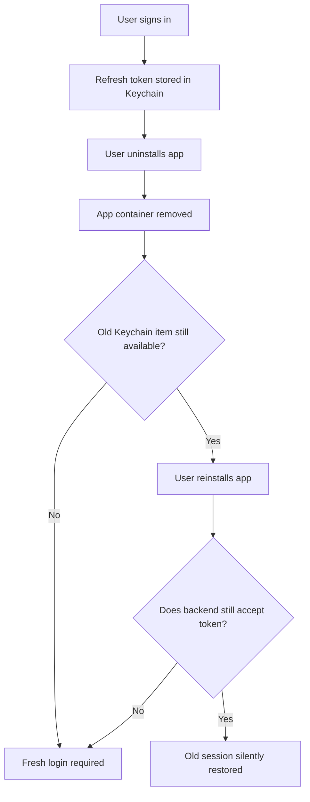
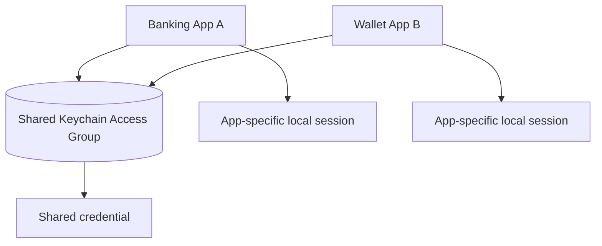

# 🔐 iOS Keychain Deep Dive — Reinstall Persistence, Access Groups & Secure Authentication Lifecycle

> **iOS Labs — Interview Polls & Deep Dives** 🍎  
> **Level:** Senior / Staff iOS Engineer  
> **Topics:** Keychain Services · Authentication · App Reinstall · Access Groups · Device Migration · Security Architecture
>
> **Don't memorize the right option. Understand the security contract, question the assumptions, and think beyond the happy path.**

---

## 👻 The Keychain Mystery: App Deleted… But the Login Survived?!

Imagine you're developing a banking / fintech iOS app.

1. The user signs in successfully.
2. The app stores a **refresh token in Keychain**.
3. The user deletes the app completely.
4. They reinstall it from the App Store.
5. On first launch, the app finds the previous refresh token, and the backend accepts it. The user is **silently signed in**. 😳

**QA:** “But I deleted the app! Why does it still remember me?”  
**Developer:** “Keychain hai bhai… app delete ho gayi, memories nahi!” 😂💔

The security team has a requirement: **a fresh installation must not silently restore an old banking session.**

There's another twist: the company has a second app that legitimately shares certain credentials through a **Keychain Access Group**.

### 🗳️ The original poll

**As the Senior iOS Engineer designing the authentication lifecycle, what's the most robust approach?**

- **A. Rely on app uninstall.** The sandbox is deleted, so Keychain credentials should automatically disappear.
- **B. Use `kSecAttrAccessibleWhenUnlockedThisDeviceOnly`.** It prevents migration and supposedly guarantees deletion on uninstall.
- **C. Detect a fresh installation and clear the appropriate Keychain credentials.** Combine that with backend session policies, token invalidation and deliberate access-group ownership.
- **D. Move refresh tokens to `UserDefaults`.** Data is removed on uninstall, so this must be safer.
- **E. Enable Keychain Sharing.** Sharing automatically manages cleanup, logout and reinstall behavior across apps.

### 🏆 Best answer: **C**

Detect the new installation **before restoring authentication**, delete the credentials that installation is not entitled to reuse, and enforce the session lifecycle on the **server**.

**Critical qualification:** Local Keychain cleanup does **not** itself revoke an issued server token. Also, the app has no guaranteed opportunity to run uninstall-time cleanup code.

The fundamental distinction is:

> **Local credential persistence ≠ device migration ≠ shared credential ownership ≠ server-side session validity.**

---

## 1. What Keychain actually is

The iOS Keychain is a security service for storing secrets such as passwords, authentication tokens and cryptographic material. It is **not** just another folder in the application's sandbox.

| Storage | Typical use | Security / lifecycle consideration |
|---|---|---|
| `UserDefaults` | Preferences, feature settings, simple flags | Not an appropriate secure vault for bearer tokens |
| Documents / Application Support | App files, database, downloads | App-container data is ordinarily removed on uninstall |
| Keychain | Credentials, tokens, protected secrets | Separate, system-managed lifecycle and access controls |
| Backend | Accounts, sessions, token validity / revocation | Authority independent of any local app installation |

### Does Keychain survive uninstall and reinstall?

**It may. Historically, it often has. But don't treat survival as a guaranteed API contract.**

Apple Developer Technical Support has explained that post-uninstall Keychain retention was an implementation detail rather than something apps should rely on. Accordingly, neither of these is a safe design assumption:

- ❌ “Uninstall always deletes Keychain items.”
- ❌ “Uninstall always preserves Keychain items.”

**Production lesson:** Define the *desired* reinstall behavior explicitly and make your application enforce it.

**Apple background:** [Apple Developer Forums — Keychain behavior following app deletion](https://developer.apple.com/forums/thread/36442).

---

## 2. How a deleted app can restore an old login



Two independent conditions can make the problem possible:

1. **Local persistence:** the credential remains accessible after reinstall.
2. **Server validity:** the backend still accepts that credential.

Solving one does not automatically solve the other.

---

## 3. Every poll option, explained

### A — Rely on uninstall to clear Keychain ❌

Uninstall ordinarily removes the app's container, but Keychain items have a distinct lifecycle. A new installation may still have access to eligible old items.

**Why this fails:** you rely on platform behavior that isn't guaranteed as the app's security contract.

### B — Use `kSecAttrAccessibleWhenUnlockedThisDeviceOnly` ❌

The suffix **`ThisDeviceOnly` does not mean “delete when the app is uninstalled.”**

It means the Keychain item is **not migrated to another device** through supported backup/restore migration mechanisms. The `WhenUnlocked` portion controls when the item is accessible.

**Why this fails:** it confuses migration policy with installation lifecycle.

### C — Detect new installation and clean up scoped credentials ✅

A robust implementation can:

1. Keep an **installation marker** in the application's own removable container.
2. Check that marker on startup **before reading refresh tokens**.
3. When it is absent, delete **only credentials owned by this app installation**.
4. Mark bootstrap complete only after cleanup succeeds.
5. Enforce backend token expiration, revocation and rotation policies.
6. Define what to do with credentials intentionally shared by another installed app.

**Important:** A missing marker is not cryptographic proof of a reinstall. It can also result from a migration from an older app version without the marker or from particular restore behaviors. Plan for those cases.

### D — Store refresh tokens in `UserDefaults` ❌

Moving bearer credentials to preferences storage just to get uninstall deletion is a **security regression**. Use Keychain with an appropriate accessibility policy, and solve lifecycle issues through explicit design.

### E — Enable Keychain Sharing and let the system handle cleanup ❌

Keychain access groups define *who may access an item*, not *when the product should revoke it*.

Both apps may legitimately be entitled to a shared item, but deleting one app must not be assumed to log out the other—or automatically remove the item.

**Senior-level takeaway:** Shared access does not imply shared logout semantics.

---

## 4. Keychain accessibility, migration and synchronization

Different Keychain policies answer different questions:

- **Accessibility:** When may a credential be accessed?
- **Migration:** Can it move to a different device through supported restoration?
- **Access control:** Must the user authenticate (for example, via biometrics)?
- **Synchronization:** Should an eligible item sync via iCloud Keychain?

| Accessibility class | When accessible | Device migration |
|---|---|---|
| `kSecAttrAccessibleWhenUnlocked` | While unlocked | Eligible for supported migration |
| `kSecAttrAccessibleWhenUnlockedThisDeviceOnly` | While unlocked | Not migrated to another device |
| `kSecAttrAccessibleAfterFirstUnlock` | After the first unlock following a restart | Eligible for supported migration |
| `kSecAttrAccessibleAfterFirstUnlockThisDeviceOnly` | After first unlock following restart | Not migrated to another device |
| `kSecAttrAccessibleWhenPasscodeSetThisDeviceOnly` | While unlocked, when a device passcode is configured | Not migrated; items are deleted when the passcode is removed |

> **Myth busted:** `ThisDeviceOnly` ≠ “delete on app uninstall.”

### Which class for a banking app?

It depends on the feature's actual access needs:

- **Foreground-only refresh token:** `WhenUnlockedThisDeviceOnly` may be reasonable where device-bound storage is desired.
- **Legitimate background authentication:** an `AfterFirstUnlock` variant may be required for access while locked; that is a meaningful security trade-off.
- **Particularly sensitive credentials:** consider a passcode-bound class or suitable `SecAccessControl` policy.

Don't apply one accessibility class to every secret just because it sounds strongest.

### Migration vs iCloud synchronization

Migration through a supported backup/restore path is different from **`kSecAttrSynchronizable`**, which controls iCloud Keychain synchronization for eligible items. Synchronization needs its own explicit security and product decision.

**Apple documentation:** [Restricting Keychain Item Accessibility](https://developer.apple.com/documentation/security/restricting-keychain-item-accessibility).

---

## 5. Secure reinstall bootstrap — Swift implementation

The requirement is straightforward:

> **A newly installed copy of the app must not automatically reuse an authentication secret from an earlier installation.**

The following examples show the **design pattern** rather than a drop-in complete authentication framework.

### Step 1 — Delete only the intended Keychain item

Avoid broad, unscoped deletion that could affect unrelated credentials or legitimate shared-group items.

```swift
import Foundation
import Security

enum KeychainCleanupError: Error {
    case unexpectedStatus(OSStatus)
}

struct AuthKeychainStore {
    let service: String
    let account: String
    let accessGroup: String?

    func deleteRefreshToken() throws {
        var query: [String: Any] = [
            kSecClass as String: kSecClassGenericPassword,
            kSecAttrService as String: service,
            kSecAttrAccount as String: account
        ]

        if let accessGroup {
            query[kSecAttrAccessGroup as String] = accessGroup
        }

        let status = SecItemDelete(query as CFDictionary)

        switch status {
        case errSecSuccess, errSecItemNotFound:
            return
        default:
            throw KeychainCleanupError.unexpectedStatus(status)
        }
    }
}
```

Here, treating `errSecItemNotFound` as success makes cleanup **idempotent**. In a real app, make sure the service/account/group uniquely identify the items you intend to manage.

### Step 2 — Store an installation marker outside Keychain

Use standard app-container storage for this marker, **not** the shared Keychain or a shared App Group preference domain.

```swift
import Foundation

@MainActor
final class InstallationBootstrap {
    private let defaults: UserDefaults
    private let keychain: AuthKeychainStore

    private let markerKey =
        "com.example.bank.installationInitialized"

    init(
        defaults: UserDefaults = .standard,
        keychain: AuthKeychainStore
    ) {
        self.defaults = defaults
        self.keychain = keychain
    }

    func prepare() throws {
        guard !defaults.bool(forKey: markerKey) else {
            return
        }

        // Discard credentials that this new installation
        // must not trust.
        try keychain.deleteRefreshToken()

        // Mark success only after cleanup succeeds.
        defaults.set(true, forKey: markerKey)
    }
}
```

### Step 3 — Run bootstrap before session restoration

```swift
let keychain = AuthKeychainStore(
    service: "com.example.bank.authentication",
    account: "refreshToken",
    accessGroup: nil
)

let bootstrap = InstallationBootstrap(keychain: keychain)

do {
    try bootstrap.prepare()
    startAuthenticationFlow()          // App-specific function
} catch {
    presentSecureRecoveryOrLogin(error) // App-specific function
}
```

The last two functions are **illustrative application entry points**, not provided framework APIs.

**Unsafe ordering:**

```text
Read old token → Restore session → Detect reinstall → Delete token
```

**Preferred ordering:**

```text
Detect installation → Clean owned credentials → Mark initialized → Restore or request authentication
```

### Production caveats

- Delete all relevant app-owned credentials, not just a single example item.
- Distinguish an actual fresh installation from an **upgrade of a legacy app** that lacks the marker.
- Handle Keychain errors by failing closed rather than accepting an old credential.
- Do not clear credentials that another still-installed application legitimately owns.
- Test backup/restore and application-data migration behavior.
- Prevent multiple initializers from racing session restoration against cleanup.
- A client-only reinstall marker **does not itself revoke an existing backend refresh token**.
- For stronger guarantees, consider a server-recognized installation/device binding with explicit renewal and revocation policy.

---

## 6. Access groups — two apps, one secret 🔑

Suppose one company operates:

- **Banking App A** — personal banking.
- **Wallet App B** — payments.

Both have the entitlement for a shared Keychain Access Group.



An access group permits entitled apps to access its items. **It does not automatically coordinate logout, cleanup, account switching or revocation.**

### Example: storing a deliberately shared item

```swift
import Security

let sharedGroup = "TEAMID.com.example.sharedcredentials"

let attributes: [String: Any] = [
    kSecClass as String: kSecClassGenericPassword,
    kSecAttrService as String: "com.example.shared.auth",
    kSecAttrAccount as String: "sharedRefreshToken",
    kSecAttrAccessGroup as String: sharedGroup,
    kSecAttrAccessible as String:
        kSecAttrAccessibleWhenUnlockedThisDeviceOnly,
    kSecValueData as String: tokenData
]

let status = SecItemAdd(attributes as CFDictionary, nil)
```

`TEAMID` and `tokenData` are placeholders. The item must be in an access group permitted by the app's entitlements. Production code must also handle duplicate items, updates and errors.

### Ownership scenarios

| Event | Policy consideration |
|---|---|
| App A freshly reinstalled | Remove App A-owned secrets; don't blindly delete B's shared secret |
| App B remains installed | Preserve legitimate shared access unless account policy requires revocation |
| Log out from App A | Is logout app-specific or account-wide? |
| User selects **Log out everywhere** | Backend revokes the appropriate sessions/token families |
| Shared credential compromised | Revoke centrally and coordinate recovery for both apps |

**Design alternative:** Sharing an account identity does **not** always require sharing a single long-lived bearer token. App-scoped tokens with a deliberate single-sign-on/session architecture may be safer and easier to revoke independently.

**Apple documentation:** [Sharing Access to Keychain Items Among a Collection of Apps](https://developer.apple.com/documentation/security/sharing-access-to-keychain-items-among-a-collection-of-apps).

---

## 7. Logout is not just a Keychain delete 🚪

Consider:

```swift
func logout() throws {
    try keychain.deleteRefreshToken()
    showLoginScreen()
}
```

The local app appears logged out, but **the backend may still accept an already-issued refresh token** held elsewhere.

### What secure logout needs

**Client side**

- Stop using the current session.
- Clear app-owned Keychain credentials and sensitive in-memory state.
- Cancel or isolate authenticated requests and background work.
- Show an unauthenticated UI state, even if the network is unavailable.

**Server side**

- Revoke the relevant refresh token, session, or token family.
- Enforce token expiry and rotation; consider refresh-token reuse detection.
- Define device logout vs account-wide logout semantics.
- Provide recovery behavior when revocation requests fail or the client goes offline.

> **Important:** Revoking refresh tokens may not immediately invalidate already-issued access tokens if the backend accepts them until expiry without an online revocation check. This depends on your token model.

### What about uninstall-time revocation?

There is **no guaranteed app-uninstall callback** that allows an iOS application to contact your backend before deletion. Server-side expiration and independent session management are therefore essential.

---

## 8. Keychain, biometrics and Secure Enclave are not synonyms

Another popular assumption:

> “The token is in Keychain, so Face ID protects it automatically.”

Not necessarily.

- **Keychain** stores protected secret items and enforces item accessibility/access control.
- **Face ID / Touch ID** can gate access when a suitable `SecAccessControl` policy is configured.
- **Secure Enclave** offers hardware-backed protection for supported cryptographic keys and operations.

Storing ordinary refresh-token data in Keychain **does not automatically create a Secure Enclave private key** or prompt for biometrics.

Use controls such as user presence or `biometryCurrentSet` when required by the actual product/security model. Consider the consequences of biometric enrollment changes and device passcode removal.

---

## 9. Senior / Staff interview bonus round

### Q1. Does Keychain always survive reinstall?

**No.** It may survive, but that retention is not a documented application-level guarantee. Build an explicit reinstall policy.

### Q2. If App A is uninstalled, must App B lose its shared credentials?

**No automatic rule guarantees that.** Credential deletion/revocation must follow the shared-session policy, not the uninstall event alone.

### Q3. Does `ThisDeviceOnly` mean “delete on uninstall”?

**No.** It restricts migration to other devices.

### Q4. Is deleting a refresh token locally a complete logout?

**No.** It stops the local app from using that copy, but backend revocation is a separate operation.

### Q5. Which items may migrate to a replacement iPhone?

Items eligible under their accessibility and migration policies may migrate through supported restore mechanisms; `ThisDeviceOnly` items do not migrate to another device. iCloud Keychain synchronization is an additional, distinct mechanism for eligible items.

### Q6. Should every credential use the same accessibility class?

**Not necessarily.** Choose based on expected access timing, background needs, migration rules and risk.

### Q7. What if the first-install marker is absent after upgrading an old app?

A naive implementation may mistakenly treat an upgrade as a reinstall and delete active credentials. Plan a **migration strategy** for versions that predate the marker.

### Q8. How do you make first-install cleanup safe for companion apps?

Track ownership of every Keychain item. Scope deletion by service/account/access group and avoid blanket deletion of shared credentials.

---

## 10. Production QA checklist

- [ ] Uninstall and reinstall after successful login
- [ ] Reinstall when an old refresh token remains in Keychain
- [ ] Reinstall when the previous Keychain item is absent
- [ ] Distinguish fresh install from legacy-app upgrade
- [ ] Simulate first-install cleanup failure
- [ ] Reinstall App A while App B retains a shared credential
- [ ] Verify app-scoped logout versus account-wide logout
- [ ] Test logout/revocation while offline
- [ ] Test refresh-token rotation and reuse detection
- [ ] Restore onto a replacement iPhone
- [ ] Verify locked-device accessibility requirements
- [ ] Test passcode removal for passcode-bound Keychain items
- [ ] Test biometric enrollment changes for protected items
- [ ] Support multiple accounts on the same device
- [ ] Verify no authentication read races ahead of installation cleanup

**Observability:** Record non-sensitive events such as `fresh_install_detected`, `keychain_cleanup_completed`, `session_restore_blocked` and `server_revocation_failed`. **Never log tokens or raw secrets.**

---

## 11. Myths vs engineering reality

| Myth | Reality |
|---|---|
| Deleting the app deletes everything | Keychain has separate lifecycle characteristics |
| Keychain always survives reinstall | Persistence across uninstall is not guaranteed |
| `ThisDeviceOnly` means cleanup on uninstall | It concerns device migration |
| Sharing one group automatically shares every credential | Access groups must be selected for items and permitted by entitlements |
| Keychain Sharing handles logout | Authentication lifecycle remains your responsibility |
| Deleting a local refresh token revokes the backend session | Local deletion and server revocation are different |
| Keychain always implies Face ID | Biometric gating requires suitable access controls |
| Uninstall can reliably notify your backend | There's no guaranteed uninstall-time execution callback |

---

## 12. Final mental model 🧠

| Component | What it controls |
|---|---|
| **Keychain** | Protected local credential storage |
| **Accessibility class** | When an item can be accessed |
| **`ThisDeviceOnly`** | Whether an item can migrate to another device |
| **Access group** | Which entitled apps may share an item |
| **Installation bootstrap** | Whether old local secrets should be trusted by this installation |
| **Backend session policy** | Whether a credential remains valid, expires or is revoked |

### Junior vs Senior perspective

**Junior question:** “Where should I store my refresh token?”

**Senior question:** “Who owns the credential? When may it be read? Can it migrate? Which apps may share it? What happens at reinstall, logout, token compromise or device replacement—and who can revoke it?”

> **Secure authentication isn't just about where you store a token. It's about controlling its entire lifecycle.** 🔐🍎

Your app might forget its installation history while remembering its credentials. 😂

---

## Further reading — Apple documentation

1. [Apple Developer Forums — Keychain behavior after app uninstall](https://developer.apple.com/forums/thread/36442)
2. [Restricting Keychain Item Accessibility](https://developer.apple.com/documentation/security/restricting-keychain-item-accessibility)
3. [Sharing Access to Keychain Items Among a Collection of Apps](https://developer.apple.com/documentation/security/sharing-access-to-keychain-items-among-a-collection-of-apps)
4. [Updating and Deleting Keychain Items](https://developer.apple.com/documentation/security/updating-and-deleting-keychain-items)
5. [Keychain Services](https://developer.apple.com/documentation/security/keychain_services)

---

### 🍎 iOS Labs — Interview Polls & Deep Dives

**Poll → Discuss → Question → Deep Dive → Learn → Share** 🚀

*Don't memorize the answer. Understand the engineering behind it.* ❤️
