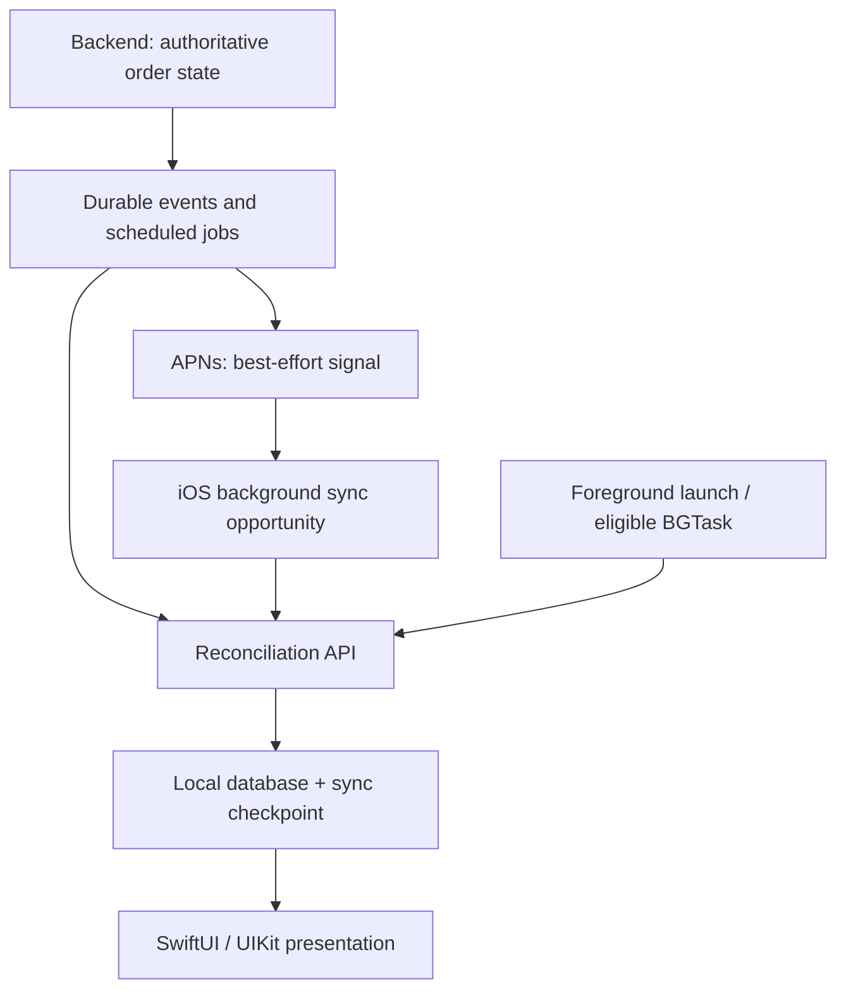

# 👻 iOS Background Execution — BGTaskScheduler, Silent Push, Force-Quit & Reliability

> **iOS Labs — Interview Polls & Deep Dives**  
> **Category:** System APIs · Background Execution · Senior iOS Engineering  
> **Takeaway:** Don't memorize APIs. Understand their guarantees, limitations, and architecture.

## 🎯 The interview scenario

You're building a delivery tracking app that needs to:

- Periodically sync delivery status.
- Refresh locally cached information.
- React to important backend updates.
- Complete pending uploads and downloads.

It works in development, but production users report inconsistent background refreshes, missed silent pushes, delayed tasks, and failures after force-quitting the app.

**Which strategy is most technically accurate?**

| Option | Proposed approach |
|---|---|
| **A** | Use `BGAppRefreshTask` every 15 minutes and rely on it to run on schedule. |
| **B** | Use silent pushes to guarantee wake-up, including after force-quit. |
| **C** | Use `BGProcessingTask` to guarantee background execution. |
| **D** | Combine eligible background APIs, design for delayed or missed execution, and keep critical workflows backend-driven. |
| **E** | Enable unrelated background modes to keep the app alive. |

**Best answer: D.** Background execution is a set of system-managed opportunities and specialized capabilities—not a general-purpose scheduling guarantee.

---

## 1. Understand the lifecycle first

| State | Meaning |
|---|---|
| **Active** | Foreground app receiving events. |
| **Inactive** | Foreground app temporarily not receiving events. |
| **Background** | App is not foregrounded; execution may be limited. |
| **Suspended** | App remains in memory but isn't executing application code. |
| **System-terminated** | iOS ends the process; eligible mechanisms may later relaunch it. |
| **User force-quit** | User explicitly removes the app from the App Switcher; automatic background relaunch is generally restricted. |

**System termination and user force-quit are not equivalent.** Specialized capabilities can have exceptions, so assess the specific API rather than assuming one universal rule.

## 2. Breakdown of every answer

### A — `BGAppRefreshTask` every 15 minutes ❌

`BGAppRefreshTask` supports short, opportunistic refreshes—not exact periodic execution.

```swift
let request = BGAppRefreshTaskRequest(
    identifier: "com.ioslabs.app.refresh"
)

request.earliestBeginDate = Date(
    timeIntervalSinceNow: 15 * 60
)

try BGTaskScheduler.shared.submit(request)
```

`earliestBeginDate` is the **earliest eligible start**, not a promise that the task runs after exactly 15 minutes. The system chooses whether and when to launch it.

**Use for:** refreshing nonurgent feeds or cached content.  
**Don't use for:** exact-time operations, guaranteed 15-minute polling, or hard business deadlines.

### B — Silent push guarantees wake-up ❌

A silent push asks iOS for an opportunity to refresh data; delivery and execution are not guaranteed.

Example APNs payload:

```json
{
  "aps": {
    "content-available": 1
  },
  "deliveryId": "ORDER-123",
  "event": "status_changed"
}
```

Relevant APNs headers:

```text
apns-push-type: background
apns-priority: 5
apns-topic: com.example.delivery
```

An APNs acceptance response **does not prove** the device delivered the notification or executed your handler. Background pushes may be delayed, throttled, or not delivered, and user force-quit generally prevents ordinary background notification delivery to the app until it is opened again.

**Production principle:** A silent push is a *signal to reconcile*, not a durable record of the business event.

### C — `BGProcessingTask` guarantees long-running work ❌

`BGProcessingTask` is designed for longer, deferrable processing, such as database maintenance or indexing. It still does not guarantee when a task will run or that it can run indefinitely.

```swift
let request = BGProcessingTaskRequest(
    identifier: "com.ioslabs.app.maintenance"
)

request.requiresNetworkConnectivity = true
request.requiresExternalPower = false

try BGTaskScheduler.shared.submit(request)
```

Plan for task expiration, cancellation, persistent checkpoints, and retry. Register task handlers and configure permitted identifiers according to Apple's BackgroundTasks documentation.

### D — Combine supported mechanisms and design for restrictions ✅

Match the work to the appropriate mechanism:

| Requirement | Mechanism |
|---|---|
| Short, nonurgent refresh | `BGAppRefreshTask` |
| Longer deferrable processing | `BGProcessingTask` |
| Opportunistic response to backend changes | Silent push |
| Supported large uploads/downloads | Background `URLSession` |
| Guaranteed business-state progression | Backend jobs/services |
| Recovery from missed events | Foreground sync + durable checkpoints |

No single iOS mechanism is appropriate for every type of work.

### E — Use unrelated background modes to keep the app alive ❌

Audio, location, and other background modes exist for **legitimate, corresponding app functionality**. They aren't a generic keep-alive mechanism. Enabling an unrelated mode to run arbitrary periodic sync work is not an appropriate design.

---

## 3. Bonus interview questions

### Q1. Is system termination the same as force-quit?

**No.** Eligible background mechanisms may relaunch an app after system termination. Explicit force-quit generally restricts ordinary automatic relaunch. Specific system services may have documented exceptions.

### Q2. APNs accepted the silent push. Did the handler run?

**Not necessarily.** APNs acceptance, device delivery, and app execution are separate outcomes. Reconcile from the backend when the app next has an opportunity.

### Q3. Does `earliestBeginDate` guarantee a deadline?

**No.** It specifies the earliest requested start, not a deadline, timer, or recurring schedule.

### Q4. A user starts uploading a 500 MB video and backgrounds the app. What would you use?

Investigate a **background `URLSession`** upload task using a file-backed request. Background sessions let the system manage supported transfers while the app is suspended or system-terminated. If the user explicitly force-quits the app, iOS cancels those background transfers rather than automatically relaunching the app to finish them.

### Q5. Can an iPhone guarantee a business-critical operation at 3:00 PM?

Not through ordinary background task scheduling. If it must occur independently of the device, schedule and execute it on a backend. The app can synchronize and display the outcome.

---

## 4. Production architecture



Recommended workflow:

1. **Backend owns order state.** Persist every change with a version or event identifier.
2. **Backend sends a signal.** Silent push improves freshness but isn't required for correctness.
3. **iOS syncs when allowed.** A delivered push, foreground launch, or eligible background task can trigger the same sync path.
4. **Sync is idempotent.** Duplicated or out-of-order signals must not regress state.
5. **Persist progress.** Save checkpoints and retry incomplete work safely.
6. **Observe real behavior.** Measure delays, failed syncs, task execution, and recovery.

### Illustrative Swift architecture

The following snippet is **conceptual**, not a drop-in implementation; `DeliveryAPI` and `DeliveryStore` represent application-specific abstractions.

```swift
actor DeliverySyncService {
    private let api: DeliveryAPI
    private let store: DeliveryStore

    init(api: DeliveryAPI, store: DeliveryStore) {
        self.api = api
        self.store = store
    }

    func synchronize() async throws {
        let checkpoint = await store.lastSyncedVersion()

        let changes = try await api.fetchChanges(
            since: checkpoint
        )

        try await store.applyAtomically(changes)
    }
}
```

`applyAtomically` should apply changes **and** advance the checkpoint within one transaction. A production implementation also needs pagination, ordering validation, concurrent-sync coordination, and retry semantics.

## 5. A related modern API: `BGContinuedProcessingTask`

`BGContinuedProcessingTask` supports eligible work **started while the user is actively using the app** that may continue after backgrounding, on supported OS versions. This is distinct from periodically waking an app to begin work at a precise time. It is not a general-purpose keep-alive service.

## 6. Common production mistakes

| Mistake | Better approach |
|---|---|
| Treat silent push as guaranteed | Reconcile from authoritative backend state |
| Treat `BGTaskScheduler` like cron | Expect opportunistic execution |
| Use ordinary foreground networking for lengthy transfers | Evaluate background `URLSession` |
| Treat force-quit and system termination identically | Test and document each lifecycle case |
| Rely solely on Xcode simulations | Test on real devices without debugger attached |
| Restart interrupted work from scratch | Persist checkpoints and make operations idempotent |
| Enable background modes as keep-alive tricks | Use only modes justified by app functionality |

## 7. What senior/staff interviewers are testing

- **Ownership:** Does the device or backend own the operation?
- **Guarantees:** What does iOS guarantee versus merely permit?
- **Lifecycle:** How do suspension, system termination, and force-quit differ?
- **Recovery:** What happens after missed pushes or interrupted transfers?
- **Observability:** How will you debug production-only behavior?
- **Trade-offs:** Which mechanism is appropriate for each workload?

## 🧠 Final mental model

- **`BGTaskScheduler`** → Request an opportunity to execute later.
- **Silent push** → Signal that remote content may have changed.
- **Background `URLSession`** → Let the system manage eligible transfers.
- **Backend** → Own operations that cannot depend on device execution.
- **Reconciliation** → Restore correctness after missed opportunities.

> **The best background architecture isn't one that assumes the app will always run. It's one that remains correct when it doesn't.** 🍎🔥

---

## 📚 Further reading — Apple Developer

- [Choosing background strategies for your app](https://developer.apple.com/documentation/backgroundtasks/choosing-background-strategies-for-your-app)
- [Pushing background updates to your app](https://developer.apple.com/documentation/usernotifications/pushing-background-updates-to-your-app)
- [BackgroundTasks framework](https://developer.apple.com/documentation/backgroundtasks)
- [URLSession background transfers](https://developer.apple.com/documentation/foundation/urlsessionconfiguration/background(withidentifier:))
- [WWDC25 — Finish tasks in the background](https://developer.apple.com/videos/play/wwdc2025/227/)

---

**iOS Labs — Learn · Discuss · Build · Share · Grow**  
*Don't memorize APIs. Understand the engineering behind them.*
