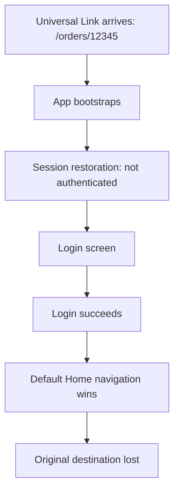
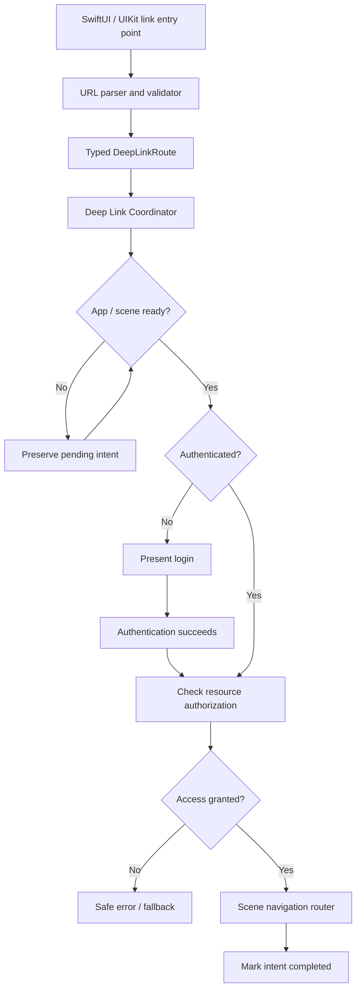

# 🔗 Universal Links & Deep Linking — Cold Starts, Authentication and Production Navigation

> **iOS Labs — Interview Polls & Deep Dives**  
> **Topics:** System APIs · SwiftUI · UIKit · Navigation Architecture · Senior/Staff iOS  
> **Core principle:** Receiving a URL is an event. Navigating to its destination is a coordinated state transition.

## 🎯 Yesterday's interview scenario

A user taps:

```text
https://app.example.com/orders/12345
```

The app cold-starts, restores its session, discovers that the user is logged out, and presents Login. After successful authentication, it opens **Home** instead of **Order #12345**. The Universal Link arrived correctly—but the intended destination was lost.

**Poll question:** What's the most robust production-ready solution?

- **A.** Navigate immediately when the link arrives.
- **B.** Store the raw URL in `UserDefaults` until login.
- **C.** Put all deep-link routing in the Login ViewModel.
- **D.** Use a centralized Deep Link Coordinator that preserves a typed navigation intent, waits for readiness, checks access, and routes through the appropriate scene.
- **E.** Delay navigation by two seconds.

### 🏆 Best answer: D

A **centralized coordinator with deferred, typed navigation intent** separates URL delivery, parsing, authentication, authorization, app readiness, and navigation.

This is not about always adding more abstractions. It is about ensuring that navigation intent has a clear owner when multiple asynchronous events compete.

---

## 1. Why this bug happens

A typical failure sequence:



Common causes:

- The link handler navigates before the navigation hierarchy is ready.
- Login completion replaces the root view or resets the navigation path.
- Session restoration and routing race against each other.
- More than one handler processes the same link.
- The pending link is stored in a short-lived view or ViewModel.
- The route is dispatched to the wrong scene/window.

**Important:** A link-delivery success does not imply navigation success.

---

## 2. Breakdown of every poll option

### A️⃣ Navigate immediately

```swift
.onOpenURL { url in
    router.navigate(to: url)
}
```

**When it can work:** The app is already authenticated, active, and its navigation stack is ready; the destination is public or immediately accessible.

**Where it breaks:** Cold starts, session restoration, login redirects, root-view replacement, or unavailable navigation state.

**Verdict:** Valid for simple flows, but not robust for the scenario.

### B️⃣ Store the raw URL in `UserDefaults`

Persistence can be useful when a pending navigation intent must survive process termination, but raw URL storage alone does not answer:

- Is the link valid and trusted?
- Which scene owns it?
- Is the route expired or already consumed?
- Does the authenticated user have access?
- What happens if another link arrives?

**Better:** If persistence is required, store a minimal, validated, non-sensitive route representation with an explicit lifetime and consumption policy. Avoid indiscriminately persisting sensitive callback URLs or tokens.

**Verdict:** Potentially useful building block, not a complete navigation architecture.

### C️⃣ Put routing in the Login ViewModel

The Login ViewModel should own **authentication**, not knowledge of every order, profile, invitation, and payment destination in the product.

Coupling login to every route creates a maintenance problem and makes navigation difficult to test independently.

**Verdict:** Poor responsibility boundary for a growing app.

### D️⃣ Centralized Deep Link Coordinator

A coordinator can:

1. Receive the link from supported app/scene entry points.
2. Parse and validate it into a typed route.
3. Preserve it while dependencies and session state initialize.
4. Request login when necessary.
5. Check authorization for the requested resource.
6. Wait until the intended scene/router is ready.
7. Navigate once and mark the intent resolved.
8. Handle duplicate, competing, expired, or failed intents according to policy.

**Verdict:** Best choice for the production scenario.

### E️⃣ Delay navigation by two seconds

```swift
DispatchQueue.main.asyncAfter(deadline: .now() + 2) {
    router.navigate(to: destination)
}
```

This is a timing workaround. Startup could take 200 milliseconds or three seconds; login might take much longer.

**Verdict:** Replace fixed delays with explicit readiness signals and state transitions.

---

## 3. Universal Links vs custom URL schemes

| Aspect | Universal Links | Custom URL schemes |
|---|---|---|
| Example | `https://app.example.com/orders/12345` | `myapp://orders/12345` |
| Association | Associated Domains + AASA file | Registered URL scheme |
| App not installed | HTTPS link can open in a browser | No automatic web fallback |
| Ownership | Verified domain-to-app association | Scheme names aren't exclusive |
| Security | Stronger association, but input still needs validation | Another app may register the same scheme |
| Common use | Shared content, invitations, order links | App integrations and callbacks |

Universal Links require an appropriate `applinks:` entitlement and a valid **apple-app-site-association (AASA)** file hosted by the associated website.

> **Authentication ≠ authorization.** A valid Universal Link never proves the user may access the requested resource. The backend must enforce access checks.

Apple: [Supporting Universal Links in Your App](https://developer.apple.com/documentation/xcode/supporting-universal-links-in-your-app).

---

## 4. Recommended production architecture



### Step 1 — Model typed routes

```swift
enum DeepLinkRoute: Hashable, Sendable {
    case order(id: String)
    case profile(id: String)
    case invitation(code: String)
}
```

The application should operate on typed routes rather than passing arbitrary URLs through every layer.

### Step 2 — Parse and validate the incoming URL

```swift
struct DeepLinkParser {
    func parse(_ url: URL) -> DeepLinkRoute? {
        guard url.scheme == "https",
              url.host == "app.example.com" else {
            return nil
        }

        let components = url.pathComponents.filter { $0 != "/" }
        guard components.count == 2 else { return nil }

        switch components[0] {
        case "orders":
            return .order(id: components[1])
        case "profiles":
            return .profile(id: components[1])
        default:
            return nil
        }
    }
}
```

**Production hardening:** Validate allowed hosts, path formats, encoded segments, query parameters, ID formats, and security-sensitive tokens. This example intentionally handles only two basic routes.

### Step 3 — Preserve the pending intent

```swift
@MainActor
final class DeepLinkCoordinator {
    private(set) var pendingRoute: DeepLinkRoute?

    func receive(_ route: DeepLinkRoute) {
        pendingRoute = route // Latest-wins policy
    }

    func takePendingRoute() -> DeepLinkRoute? {
        defer { pendingRoute = nil }
        return pendingRoute
    }
}
```

This is a **minimal illustration**, not a complete production coordinator. In a real app, model the states **pending → resolving → completed/failed**. Don't consume an intent prematurely if asynchronous authorization or navigation might fail. Add retry/expiration rules and deduplication where appropriate.

### Step 4 — Model readiness explicitly

```swift
enum AppReadiness {
    case bootstrapping
    case unauthenticated
    case authenticated
}
```

Authentication isn't the only readiness condition. The scene, root navigation hierarchy, and required services may also need to be ready. Trigger routing from actual state changes, not a hard-coded timer.

### Step 5 — Verify authorization

```swift
func resolveOrder(id: String) async throws -> Order {
    try await orderRepository.fetchAuthorizedOrder(id: id)
}
```

This illustrative repository call must rely on **server-enforced authorization**. If access is denied or the order no longer exists, show a safe error/fallback and resolve the pending intent appropriately.

### Step 6 — Route through the intended scene

```swift
@MainActor
@Observable
final class NavigationRouter {
    var path: [DeepLinkRoute] = []

    func navigate(to route: DeepLinkRoute) {
        path.append(route)
    }
}
```

This is a simplified SwiftUI `NavigationStack` router. In UIKit, a `UINavigationController` coordinator can resolve the same typed route. Share parsing and policy, but keep **scene navigation state scene-owned**.

---

## 5. Cold start, warm start, and link entry points

| App situation | Primary risk |
|---|---|
| Foreground | Duplicate pushes or competing navigation |
| Background | Restoring the intended scene and navigation state |
| Cold start | Losing the link during startup/root-view setup |
| Logged out | Losing the route across authentication |
| Expired session | Refresh/re-authentication before routing |
| Multiple scenes | Sending the link to the wrong window |

### SwiftUI

```swift
WindowGroup {
    RootView()
        .onOpenURL { url in
            deepLinkHandler.receive(url)
        }
}
```

Use `.onOpenURL` as an **entry point**; delegate orchestration to the routing layer.

### UIKit with scenes

```swift
func scene(
    _ scene: UIScene,
    continue userActivity: NSUserActivity
) {
    guard userActivity.activityType == NSUserActivityTypeBrowsingWeb,
          let url = userActivity.webpageURL else {
        return
    }

    deepLinkHandler.receive(url)
}
```

For scene-based cold starts, also inspect `UIScene.ConnectionOptions.userActivities` during scene connection. Delivery paths depend on lifecycle configuration and whether a scene already exists; don't assume every launch uses one callback.

---

## 6. Bonus round — Senior/Staff interview questions

### Q1. Two links arrive before login completes. Which should open?

There is **no universal policy**:

| Policy | Behavior | Trade-off |
|---|---|---|
| Latest-wins | Navigate to newest intent | Earlier intent replaced |
| Queue | Process in arrival order | May cause surprising navigation chains |
| Scene-specific | Maintain intent per scene | More state/ownership complexity |

Latest-wins is often reasonable for ordinary content links. Payment, invitation, and transaction flows may need different handling. Make the policy explicit and testable.

### Q2. Login succeeds, but the order belongs to someone else

Authentication identifies the user; authorization determines resource access. The backend must deny unauthorized access. The app should show an appropriate error or fallback and prevent an endless loop of retrying the same forbidden route.

### Q3. Two iPad windows are open

Share URL parsing and authentication where appropriate, but avoid a single global navigation path for all scenes. Each scene should own its navigation state, and routing should respect the scene selected by the platform.

### Q4. `.onOpenURL` fires, but nothing navigates

Investigate readiness, root-view replacement, competing navigation writes, duplicate handlers, and premature intent consumption **before** blaming Universal Link delivery.

### Q5. Should pending links survive process death?

Sometimes. Persist only a validated, minimal, non-sensitive intent with suitable expiration and consumption rules. Security-sensitive and single-use callbacks need specialized handling.

---

## 7. Production QA checklist

- [ ] Cold start while authenticated
- [ ] Cold start while logged out
- [ ] Warm start from foreground and background
- [ ] Session expires during route resolution
- [ ] Login succeeds but resource authorization fails
- [ ] Two links arrive before authentication completes
- [ ] Same link is handled more than once
- [ ] App terminates during authentication
- [ ] Requested resource was deleted
- [ ] Multiple iPad scenes are open
- [ ] Link opens in a browser when the app isn't installed
- [ ] Navigation restoration competes with the pending link

For observability, log lifecycle milestones **without sensitive URLs/tokens**:

```text
link_received
route_parsed
route_pending
authentication_required
authentication_completed
authorization_succeeded
navigation_started
navigation_completed
```

These events help distinguish link-delivery failures from navigation-coordination failures.

---

## 8. Trade-offs: do you always need a coordinator?

**No.** A small app with one public route might need only a simple `.onOpenURL` handler. A complex production app benefits from a dedicated routing abstraction when it has authentication gates, many destinations, multiple scenes, state restoration, and competing asynchronous transitions.

The coordinator adds architectural and state-management complexity. In return, it makes behavior more predictable, testable, and extensible.

> The goal isn't maximum abstraction. It's clear ownership of navigation intent.

---

## 9. Final mental model

| Component | Responsibility |
|---|---|
| Universal Link | Express navigation intent |
| Parser & validator | Determine whether the URL maps to a supported route |
| Pending intent | Preserve the request until it can be resolved |
| Authentication | Determine who the user is |
| Authorization | Determine whether the user can access the resource |
| Scene router | Navigate when the intended UI is ready |
| Consumption policy | Prevent stale, duplicate, or lost navigation |

### 🧠 Senior-level takeaway

A basic implementation asks:

> “How do I open a screen from a URL?”

A production-ready implementation asks:

> “How do I preserve, validate, authorize, and resolve navigation intent across asynchronous lifecycle transitions without losing or duplicating it?”

**Think intent. Think lifecycle. Think ownership. Think security.** 🍎🔥

---

## Further reading

- [Apple — Supporting Universal Links in Your App](https://developer.apple.com/documentation/xcode/supporting-universal-links-in-your-app)
- [Apple — SwiftUI `onOpenURL(perform:)`](https://developer.apple.com/documentation/swiftui/view/onopenurl(perform:))

---

**iOS Labs — Don't memorize the answer. Understand the engineering behind it.** ❤️
